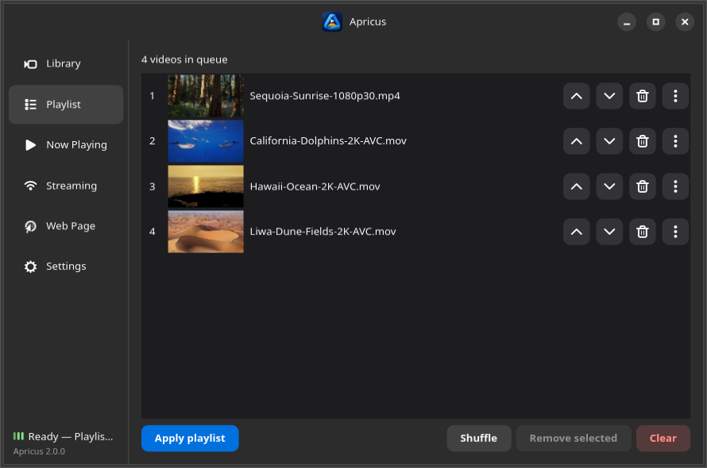

<p align="center"></p>

<p align="center">Live wallpaper for Linux. Written in Python.</p>
<p align="center">Apricus (lat.) — sunny, exposed to the sun.</p>

<p align="center">
<a href="https://github.com/fabx-dev/apricus/actions/workflows/ci.yml"></a>
</p>

# Apricus

Apricus is a community fork of [Hidamari](https://github.com/jeffshee/hidamari)
by Jeff Shee (GPL-3.0, same license). It picks up where Hidamari left off:
**fast login startup, a robust player, per-monitor correctness, and a cleaner
path to Wayland and multi-desktop support**.

> Status: active development on `master`.

## Features

- Autostart after login (`.desktop` file or user systemd unit)
- Instant wallpaper at login: last frame applied immediately, refreshed in background
- Static wallpaper from video frame, with blur effect <sup>1</sup>
- Pause on maximized window / fullscreen <sup>2</sup>
- Volume control, mute/pause in two clicks
- I'm feeling lucky (random video)
- Hardware accelerated decoding via VLC <sup>3</sup>
- Multi-monitor support, per-monitor video <sup>4</sup>
- Streaming URL support via yt-dlp <sup>5</sup>
- Webpage as wallpaper <sup>6</sup>

<sup>1</sup> Currently GNOME only.
<sup>2</sup> Window-state detection is currently X11 only. On Wayland the video
still plays (rendered via XWayland); auto-pause there needs a Shell extension
companion, which is on the roadmap.
<sup>3</sup> VLC backend; HW acceleration varies by driver (NVIDIA + Wayland is fragile).
<sup>4</sup> Duplicate monitor models get stable `Model#i` config keys, so two
identical screens no longer overwrite each other.
<sup>5</sup> Tested with YouTube.
<sup>6</sup> Anything from a plain page to WebGL content.

## What changed vs upstream

- Startup: shared process clock with `[Perf]` marks, persistent static-frame
  cache + background refresh, `ffprobe` sidecar cache, `--fast` mode and a
  user systemd unit — login-to-first-frame went from ~1.7s to ~1.4s (1080p)
- Player: no redundant seeks on startup, single-shot monitor sync, logging
  that actually works in forked children
- Config: legacy Hidamari setup is imported automatically on first run;
  videos stay in the existing `~/Video(s)/Hidamari` folder
- Correct dark-mode wallpaper restore, `feeling_lucky` fixed on empty
  libraries, `ffprobe` timeouts, headless-safe imports
- Desktop-environment backends (`apricus.backends`): GNOME vs generic
  wallpaper handling and X11 vs Wayland window-state selection in one place
- Full rebrand: `io.github.fabx_dev.Apricus` app ID, D-Bus names, icon, docs
- CI (lint + format check + pytest) and a headless-safe test suite

## Installation (from source)

Prerequisites per distro are listed in [docs/dev.md](docs/dev.md) — note that
the native `vlc` and `ffmpeg` packages are required (the Flatpak bundles
them). Then:

```bash
git clone --recurse-submodules https://github.com/fabx-dev/apricus.git
cd apricus
make sync      # dev environment (uses system PyGObject)
make install   # installs into ~/.local (no sudo)
```

Run it (via the dev env, in debug mode):

```bash
make run
```

Put videos in the video folder (`~/Video/Hidamari` or `~/Videos/Hidamari`
depending on distro, kept from Hidamari for compatibility) and pick them from the GUI.
You can point Apricus at any folder with the *Choose video folder* button in the control panel.

A Flatpak (`io.github.fabx_dev.Apricus`) builds locally with `make flatpak`; Flathub publishing is planned.

Optional login autostart via systemd (instead of the `.desktop` file):

```bash
apricus --systemd-enable    # disable with --systemd-disable
```

## Development

```bash
make lint     # ruff check
make format   # ruff format
uv run pytest tests/ -q
```

Issues and pull requests are welcome.

## Credits

- Upstream project: [jeffshee/hidamari](https://github.com/jeffshee/hidamari)
- App icon: original to Apricus
- License: GPL-3.0-or-later (see `COPYING`)

## Screenshots




