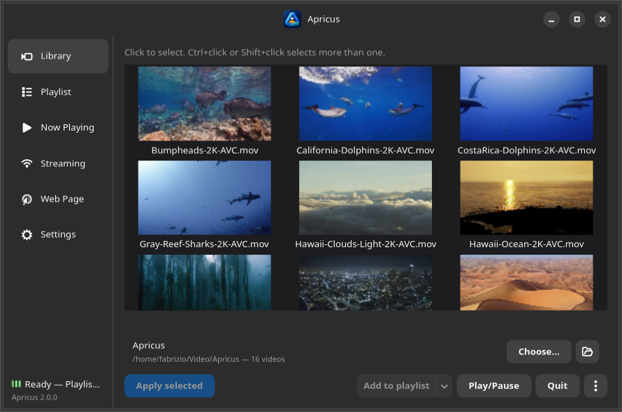
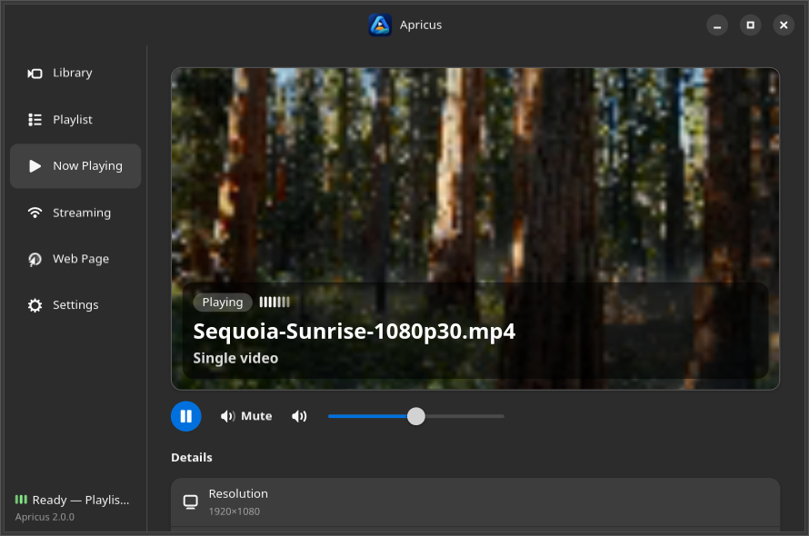
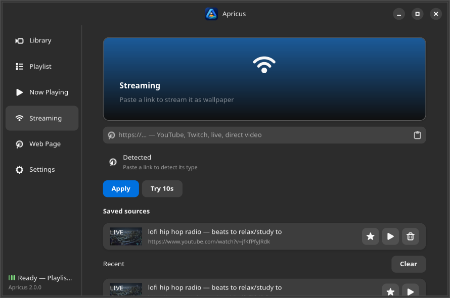
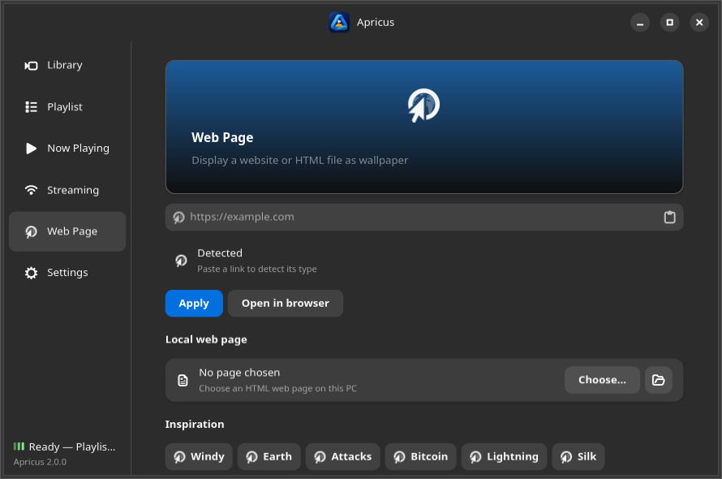
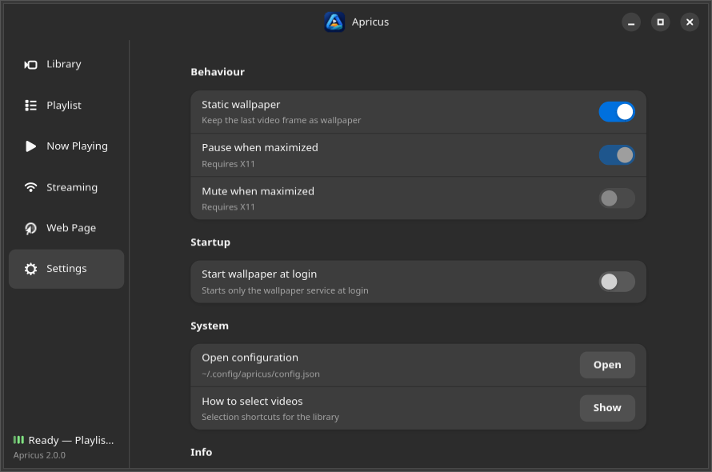

<p align="center"></p>

<h1 align="center">Apricus 2.0</h1>

<p align="center"><strong>Bring your GNOME desktop on Linux to life — local videos, looping playlists, live streams &amp; interactive web wallpapers.</strong></p>
<p align="center"><em>Apricus (lat.) — sunny, warmed by the sun.</em></p>

<p align="center">
  <a href="https://github.com/fabx-dev/apricus/releases/latest"></a>
  <a href="https://github.com/fabx-dev/apricus/actions/workflows/ci.yml"></a>
  <a href="https://github.com/fabx-dev/apricus/actions/workflows/release-packages.yml"></a>
  <a href="https://snapcraft.io/apricus"></a>
  <br>
  <a href="COPYING"></a>
  
  
</p>

---

**Apricus 2.0** transforms your **GNOME desktop** background on Linux (Ubuntu, Fedora Workstation, Debian, Zorin OS, Pop!_OS GNOME, and other Mutter/X11 desktops) into a fluid, living canvas — without draining resources or getting in your way. Set a 4K local clip on one monitor, a muted looping playlist on another, a live YouTube/Twitch stream, or an interactive WebGL globe, and let Apricus automatically pause or mute the moment you maximize a work window.

Apricus 2.0 is a community fork of [Hidamari](https://github.com/jeffshee/hidamari), building on the original project with additional features and architectural changes. It introduces a GTK4 and Libadwaita control center, a persistent playback engine designed to avoid gaps during playback, visual playlists with drag-and-drop support and undo, a live Now Playing dashboard, and dedicated streaming and web hubs with favorites, thumbnails, and 10-second previews. Other changes include optimized startup time (under 1.5 seconds at login) and improved network security.

---

## ✨ What's New & Different in Apricus 2.0

### 1. A Brand-New GTK4 + Libadwaita Control Center
The legacy 3-tab GTK3 window has been replaced by a native **GTK4 + Libadwaita** application organized around six dedicated workspaces in a persistent sidebar:
- **Library** — Asynchronous thumbnail grid that never freezes the UI, free choice of your video folder, multi-selection (`Ctrl`/`Shift`+click), and an interactive per-monitor selector whenever you apply a wallpaper.
- **Playlist** — Build muted looping queues with visual thumbnail rows, **drag-and-drop** reordering, move to top/bottom actions, **Shuffle**, and instant **Undo** toasts. Switching temporarily to a single video never wipes your queue — it stays saved and ready to resume.
- **Now Playing** — A live dashboard featuring a widescreen 16:9 hero preview, real-time status badge (`Playing`, `Paused`, `Playlist in loop`, `Web page`, `Static`) with an animated equalizer, play/pause and volume/mute transport bar, media inspector (resolution, duration, format/quality, source folder or domain), and an **Up next** preview of your queue.
- **Streaming** — Paste any YouTube, Twitch, live stream or direct video link:
  - **Live link detector** identifies direct streams vs video pages and warns you on unsupported playlist/channel URLs;
  - **Try 10s** lets you preview a stream on your desktop for 10 seconds (with an instant *Stop now* button) before applying it;
  - **Saved sources** (favorites) and **Recent** history with lazy, deduplicated thumbnail caching, monogram fallbacks, and a verified **LIVE** badge;
  - Out-of-the-box YouTube & HTTPS playback in the Flatpak thanks to the bundled **Deno 2.9** JS runtime and a patched **libVLC TLS Fast Open** fallback.
- **Web Page** — Turn any website, dashboard, shader or local `.html` file into your wallpaper:
  - Live reachability and `<title>` inspector as you type;
  - Built-in **Inspiration** gallery (*Windy*, *Earth*, *Cyber Attacks*, *Bitcoin*, *Lightning*, *Silk*) ready to load in one click;
  - Saved pages, recent history, and drag-and-drop support for `.html` files and URLs.
- **Settings** — One-click toggles for GNOME static wallpaper sync, automatic pause/mute on maximized windows, login autostart, and quick access to the configuration file.

### 2. Gapless In-Place Engine & ~1.4s Login Startup
- **Zero-gap switching**: changing video or mode no longer kills and respawns the player process. The live player switches media **in place**, painting the incoming video's cached frame over the old one until decoding begins — no desktop flash, no black gap.
- **Instant login wallpaper**: a sharp static frame cache is applied immediately at login and refreshed in the background, paired with an `ffprobe` metadata sidecar cache, a `--fast` login flag, and an optional user `systemd` service (`apricus --systemd-enable`).
- **Real-time error recovery**: if a stream or media source fails before or during playback, the player reports it over D-Bus and the control panel surfaces a top-level **Retry** banner instead of leaving a silently frozen screen.

### 3. Multi-Monitor Precision, Security & 6 Complete Languages
- **Per-monitor accuracy**: identical monitor models receive deterministic `Model#i` keys ordered by screen geometry, so dual monitors of the same model never overwrite each other.
- **SSRF & download hardening**: every app-controlled HTTP request and every redirect hop is validated against private, loopback and link-local addresses before reading a single byte, with strict incremental size caps and subprocess timeouts.
- **100% localized in 6 languages**: every string in the GTK4 interface is translated into **English**, **Italian**, **German**, **French**, **Spanish** and **Japanese**.

---

## 📊 Apricus 2.0 vs Legacy Hidamari (3.7)

| Capability | Legacy Hidamari (3.7) | Apricus 2.0 |
|---|---|---|
| **User Interface** | GTK3 window with 3 basic tabs (*Local Video*, *Streaming*, *Web Page*) | **GTK4 + Libadwaita** control center with 6 workspaces (*Library*, *Playlist*, *Now Playing*, *Streaming*, *Web Page*, *Settings*), toasts & status banners |
| **Video Playlists** | ❌ Single video only | ✅ **Visual looping playlists** with thumbnails, drag-and-drop, shuffle, undo & per-monitor queues |
| **Now Playing View** | ❌ None | ✅ **16:9 hero preview**, live equalizer, transport controls, media metadata & *Up next* queue |
| **Streaming Experience** | Bare URL text box; no history, no preview, no thumbnails | ✅ **Favorites & recent history**, cached thumbnails, **LIVE** badge, link type detector & **Try 10s** live preview |
| **Flatpak Streaming** | Often broke on YouTube / HTTPS in modern sandboxes | ✅ **Bundled Deno 2.9 runtime** + **patched libVLC TLS Fast Open fallback** + static wallpaper pinned under streams |
| **Web Wallpapers** | Bare URL entry + local file picker | ✅ **Live reachability & `<title>` probe**, **Inspiration** presets, favorites, recent history & drag-and-drop |
| **Media Switching** | Kills & respawns player process (visible desktop flash) | ✅ **In-place switching** with static cover frame painted over the transition (zero gap) |
| **Login Startup** | ~1.7s+, re-generates blurred frame via Pillow on every boot | ✅ **~1.4s startup**, persistent sharp static-frame cache, `ffprobe` sidecar cache, `--fast` mode & `systemd` unit |
| **Multi-Monitor** | Identical monitor models overwrote each other | ✅ **Unique `Model#i` keys** + interactive monitor chooser on apply |
| **Error Handling** | Silent black/frozen wallpaper on stream failure | ✅ **D-Bus `playback_error` reporting** with top-level **Retry** banner in the GUI |
| **Network Security** | Unguarded fetches, no SSRF or redirect validation | ✅ **Hop-by-hop SSRF protection** (`fetch_public`), incremental byte caps, UID checks & atomic `.bak` config saves |
| **Translations** | Partial GTK3 translations | ✅ **100% translated (170 strings)** in EN, IT, DE, FR, ES and JA |

---

## 🖼️ Screenshots

| Library | Playlist |
|---|---|
|  |  |

| Now Playing | Streaming |
|---|---|
|  |  |

| Web Page | Settings |
|---|---|
|  |  |

---

## 📦 Installation

### Flatpak Bundle (Recommended)

Ready-made Flatpak bundles are attached to each [GitHub Release](https://github.com/fabx-dev/apricus/releases):

```bash
flatpak install --user apricus-2.0.7.flatpak apricus-locale.flatpak
```

Or build and install locally from source (pulls runtime/SDK from Flathub):

```bash
make flatpak
```

### Debian / Ubuntu (`.deb` Package)

Download `apricus_2.0.7_amd64.deb` (or `arm64`) from the [GitHub Release](https://github.com/fabx-dev/apricus/releases) and install it with `apt`:

```bash
sudo apt install ./apricus_2.0.7_amd64.deb
```

Or build the `.deb` locally into `dist/`:

```bash
make deb
```

### Fedora (`.rpm` Package)

Download `apricus-2.0.7-1.x86_64.rpm` (or `aarch64`) from the [GitHub Release](https://github.com/fabx-dev/apricus/releases) and install it with `dnf`:

```bash
sudo dnf install ./apricus-2.0.7-1.x86_64.rpm
```

Or build the `.rpm` locally into `dist/`:

```bash
make rpm
```

### Snap Package

[](https://snapcraft.io/apricus)

Install from the [Snap Store](https://snapcraft.io/apricus) (or from the `.snap` package attached to the release):

```bash
sudo snap install apricus
```

### From Source (Local Prefix)

System prerequisites per distribution are listed in [docs/dev.md](docs/dev.md) (`vlc`, `ffmpeg`, `yt-dlp`, `deno`, PyGObject and GTK4/Libadwaita typelibs).

```bash
git clone --recurse-submodules https://github.com/fabx-dev/apricus.git
cd apricus
make sync      # create/refresh uv environment (uses system PyGObject)
make install   # install into ~/.local (no sudo required)
make run       # launch in debug mode
```

Optional low-contention login autostart via user `systemd` unit:

```bash
apricus --systemd-enable    # disable anytime with: apricus --systemd-disable
```

---

## 🔄 Upgrading from Apricus 1.0 or Hidamari

- **Same Application ID** (`io.github.fabx_dev.Apricus`) and configuration path (`~/.config/apricus/config.json`).
- **Automatic Config Migration & Backup**: Apricus 2.0 reads 1.0 configurations directly, backfills new keys without overwriting your choices, and writes a byte-identical rollback copy to `~/.config/apricus/config.json.bak`. Existing Hidamari video folders (`~/Videos/Hidamari`) are reused automatically if present.
- **D-Bus Scripting**: `video`, `stream` and `webpage` D-Bus methods take `(source, monitor)` — pass `"all"` to apply across all monitors.

### Desktop Environment Compatibility

| Desktop Environment | Session | Playback | Desktop Icons | Static Wallpaper | Auto-Pause on Maximize |
|---|---|---|---|---|---|
| **GNOME** (Ubuntu, Fedora, Debian, Zorin OS) | Wayland & X11 | ✅ Full | ✅ With Shell integration (4) / X11 native | ✅ Supported | ✅ X11 (Wayland planned) |
| **Budgie / Pantheon** | X11 | ✅ Works | — | ❌ GNOME only | ✅ Supported |
| **Cinnamon / XFCE / MATE** | X11 | ⚠️ Partial (1) | ⚠️ Conflicts with desktop manager | ❌ GNOME only | ✅ Supported |
| **KDE Plasma** | Wayland / X11 | ❌ Not supported (2) | — | — | — |

1. On Cinnamon, XFCE and MATE, the file manager (`nemo-desktop`, `xfdesktop`, `caja`) draws its own opaque desktop window; desktop icons must be disabled for the video layer to remain visible.
2. KDE Plasma's `plasmashell` manages its own background surface and blocks external `_NET_WM_WINDOW_TYPE_DESKTOP` windows (use a native Plasma wallpaper plugin on KDE).
3. On GNOME **Wayland** without the Shell integration below, a live wallpaper may cover desktop icons (DING / GTK4-DING): the compositor ignores X11 restacking of desktop-layer windows and DING always lowers itself below other desktop windows, so no application-side workaround exists (verified against Mutter 18 and the DING sources). Either enable the integration (4) or log in with an **X11 session** ("Ubuntu on Xorg" at login), where icon stacking works natively.
4. **GNOME Wayland desktop-icons integration** (GNOME Shell 50 only; 51 not yet verified): Apricus ships a tiny companion extension, `apricus-integration@fabx-dev` (source in `gnome-extension/`), that hosts the wallpaper windows in the Shell's background layer — below DING icons and application windows. This requires pixmap rendering: on GNOME Wayland the player forces VLC `--vout=xcb` (GPU-direct outputs bypass the pixmap via overlay planes that always composite on top; Xorg keeps hardware presentation). Hardware decoding stays automatic where drivers support surface download; where only a virtual GPU exists the player falls back to software decoding. A GPU-assisted alternative verified on GNOME 50.1 (`--vout=xv`, textured XVideo, composited and orderable) can be selected with `APRICUS_VOUT=xv`. Native `.deb`/`.rpm` packages install the extension to `/usr/share/gnome-shell/extensions/` automatically; local `make install` puts it under `~/.local/share/gnome-shell/extensions/`. Enable once with `gnome-extensions enable apricus-integration@fabx-dev`, then log out and back in. Snap/Flatpak cannot install host extensions from their sandbox: run `gnome-extension/install-host.sh --enable` from the source tree (or copy the extension dir to `~/.local/share/gnome-shell/extensions/` manually) and enable it the same way. Without the extension, GNOME Wayland falls back to legacy stacking (icons may be covered); Xorg and other desktops are unaffected. Note: with the integration active, right-clicking the wallpaper reaches DING instead of Apricus — use the control center for wallpaper actions.
   - **Setup status**: on GNOME Wayland, Settings shows a *Desktop icons* row (Active / needs logout-login / disabled with an Enable button / unsupported GNOME / load error). The row never appears on other sessions.
   - **Troubleshooting**: after install+enable, the video stays behind the icons only once the Shell loads the extension (logout/login required). Confirm with `journalctl --user -g apricus-integration` (expect `enabled, code revision N` and `adopted "…" into the background layer`). If the extension disappears after a GNOME upgrade, it was fenced by `shell-version`: wait for an Apricus update that declares the new Shell.

### Additional Notes

- **Flatpak Sandbox & Video Folders**: the Flatpak uses read-only `xdg-videos:ro` access. Keep your video library inside your `Videos` folder (or grant extra folder permissions with Flatseal if using an external drive).
- **Local Network URLs**: to prevent SSRF abuse from pasted links or redirects, Apricus refuses private/loopback (`localhost`, `192.168.x.x`, `10.x.x.x`) stream and web URLs.

---

## 🛠️ Development & Testing

```bash
make lint                    # ruff check src/
make format                  # ruff format src/
uv run pytest tests/ -q      # headless test suite
```

Update translation catalogs (`po/*.po`):

```bash
make pot
make update-po
```

---

## 📄 Credits & License

- **Author & Maintainer**: [fabx-dev](https://github.com/fabx-dev)
- **Original Upstream Project**: [Hidamari](https://github.com/jeffshee/hidamari) by Jeff Shee
- **License**: GPL-3.0-or-later (see [COPYING](COPYING))
