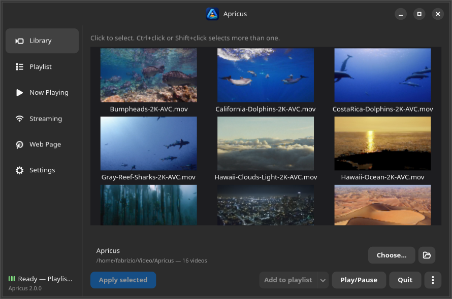
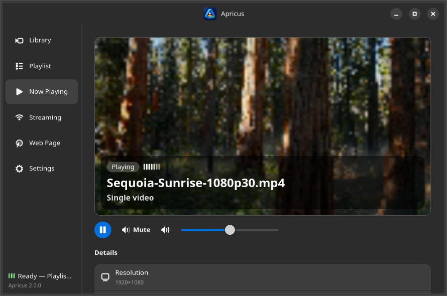
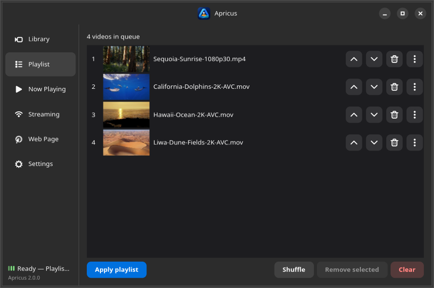
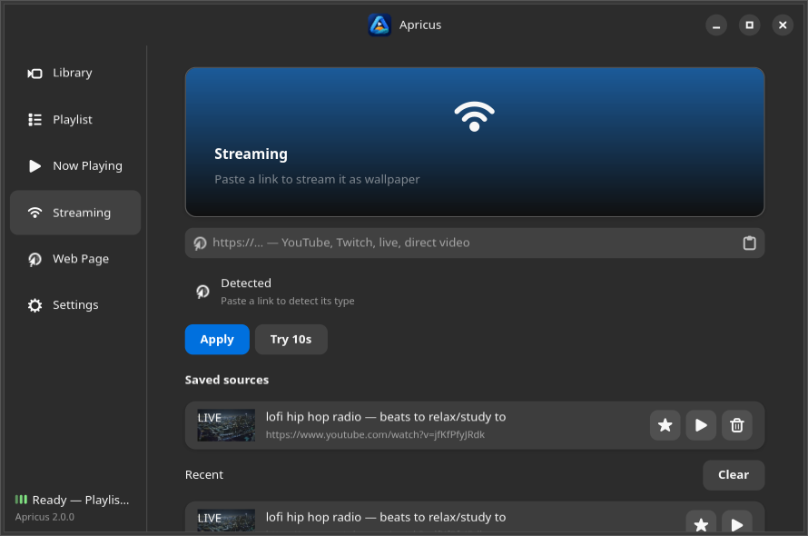
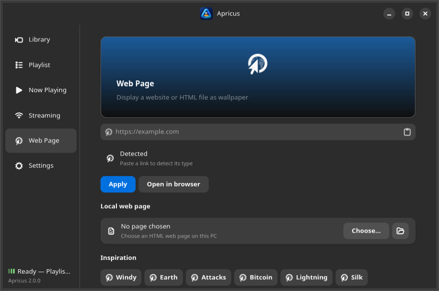
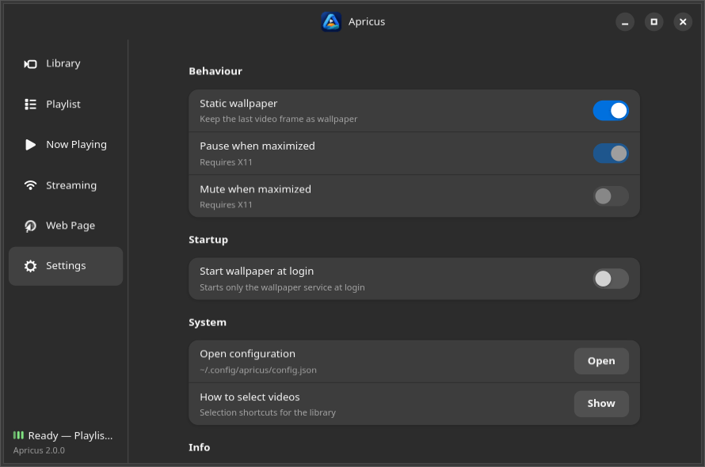

<p align="center"></p>

<h1 align="center">Apricus 2.1.0</h1>

<p align="center"><strong>Live wallpaper for the GNOME desktop on Linux — local videos, playlists, streams and web pages.</strong></p>
<p align="center"><em>Apricus (lat.) — sunny, warmed by the sun.</em></p>

<p align="center">
  <a href="https://github.com/fabx-dev/apricus/releases"></a>
  <a href="https://github.com/fabx-dev/apricus/actions/workflows/ci.yml"></a>
  <a href="https://snapcraft.io/apricus"></a>
  <br>
  <a href="COPYING"></a>
  
  
</p>

---

Apricus turns your GNOME desktop background into a living canvas: a local clip, a looping playlist, a live stream, or an interactive web page. It is a community fork of [Hidamari](https://github.com/jeffshee/hidamari), rebuilt around a GTK4 + Libadwaita control center, a server-owned playback policy engine, and a GNOME Shell integration for fullscreen/maximized awareness on Wayland.

Why Apricus:

- Native GTK4 control center with Library, Playlist, Now Playing, Streaming, Web Page and Settings workspaces.
- Playback Policy Engine: automatic pause/mute rules that always yield to your explicit Play, Pause and Stop.
- GNOME Wayland integration: fullscreen/maximized sensing through a small Shell extension, with preferences that apply immediately.
- Per-monitor wallpaper selection, static-frame login continuity, and six interface languages.

---

## What's new in 2.1.0

2.1.0 closes the M1–M3 cycle. No suspend/resume (M4) behavior is included.

**M1 — Playback controls**

- New **Now Playing** panel with media hero, status badge, transport and media details.
- Dynamic **Play/Pause** button plus a separate **Stop** button.
- Explicit manual actions are persisted and always take precedence over automation.

**M2 — Playback Policy Engine**

- One server-owned engine decides every playback transition.
- Manual pause/stop latches survive restarts; automatic reasons never clear them.
- Pause/mute preferences for maximized windows, applied to the current state without restarts.
- Playlist selection, position and queue behavior kept consistent with the policy.

**M3 — GNOME Wayland integration**

- The Shell extension reports fullscreen/maximized truth over a dedicated versioned D-Bus channel.
- The server validates sender and sequence, reconciles on reconnect, and freezes safely on signal loss.
- Preferences changed in the GUI reach the running server immediately.

See [RELEASE_NOTES_2.1.0.md](RELEASE_NOTES_2.1.0.md) and [CHANGELOG.md](CHANGELOG.md) for the full notes.

---

## Features

- **Local video wallpapers** from your video folder, with asynchronous thumbnails and per-monitor selection.
- **Looping playlists** with drag-and-drop reorder, shuffle and undo.
- **Streams**: YouTube, Twitch, live and direct video links, with 10-second preview, favorites and history. Native packages bundle Deno and yt-dlp; some YouTube videos may not play reliably. The Streaming information button explains this limitation on demand.
- **Web pages**: any URL or local `.html` file as wallpaper, with an Inspiration gallery.
- **Multi-monitor**: deterministic per-monitor selection, including identical models.
- **Now Playing**: live status, transport (Play/Pause, Stop, volume/mute), media inspector and up-next preview.
- **Policy automation**: pause or mute when a window is fullscreen/maximized, configurable in Settings.
- **GNOME integration**: companion extension `apricus-integration@fabx-dev` keeps wallpaper below DING icons and application windows, and feeds window state to the policy engine.

---

## Screenshots

Screenshots live in `res/` and show the current GTK4 interface:








> Note: the Settings screenshot still shows the previous “Requires X11” subtitle. In 2.1.0 the pause/mute rows are editable on capable GNOME Wayland and explain the extension requirement instead. An updated Settings screenshot is still needed; see the report.

---

## Installation

Published packages are attached to [GitHub Releases](https://github.com/fabx-dev/apricus/releases). **2.1.0 is currently an unpublished local candidate.** Filenames below describe the intended 2.1.0 packages, not a claim that they are already available.

### Debian / Ubuntu (`.deb`)

```bash
sudo apt install ./apricus_2.1.0_amd64.deb
```

Or build locally into `dist/`:

```bash
make deb
```

### Fedora / compatible distributions (`.rpm`)

```bash
sudo dnf install ./apricus-2.1.0-1.x86_64.rpm
```

Or build locally into `dist/`:

```bash
make rpm
```

### Flatpak

```bash
flatpak install --user apricus-2.1.0.flatpak apricus-locale.flatpak
```

Or build locally from source (pulls the GNOME 50 runtime/SDK from Flathub):

```bash
make flatpak
```

### Snap

```bash
sudo snap install apricus
```

This installs the currently published Store version (2.0.7 rev15 during local 2.1.0 preparation), not the unpublished candidate. For an explicitly approved local test, quit Apricus first and verify its app/helper processes have exited, then use `sudo snap install --dangerous ./apricus_2.1.0_amd64.snap`. The Snap remains strict-confined. Back up user data before replacing an installation; see the release readiness report for upgrade reservations.

### From source

Prerequisites per distribution are listed in [docs/dev.md](docs/dev.md).

```bash
git clone --recurse-submodules https://github.com/fabx-dev/apricus.git
cd apricus
make sync      # create/refresh uv environment (uses system PyGObject)
make install   # install into ~/.local (no sudo required)
make run       # launch in debug mode
```

---

## GNOME integration

Apricus ships a companion extension, `apricus-integration@fabx-dev` (source in `gnome-extension/`), revision 6 in this release:

- Hosts wallpaper windows in the Shell background layer, below DING icons and app windows.
- Reports fullscreen/maximized state to the server over `org.gnome.Shell.Extensions.ApricusIntegration`.
- Carries no playback logic and no window identities — only aggregate state.

Setup:

1. Native `.deb`/`.rpm` installs place the extension under `/usr/share/gnome-shell/extensions/`. For Snap/Flatpak, which cannot write host extension directories from their sandbox, build the ZIP with `gnome-extension/build-zip.sh` and run `gnome-extension/install-host.sh --zip <file.zip> --enable` on the host (per-user, no sudo).
2. Enable once: `gnome-extensions enable apricus-integration@fabx-dev`.
3. Log out and back in so the Shell loads the new code.
4. Confirm with `journalctl --user -g apricus-integration` (expect `enabled, code revision 6`).

Updating works the same way: overwrite the files, then log out/in. Removing Apricus never touches `~/.local/share/gnome-shell/extensions/`; disable and delete that directory manually if desired.

Package differences:

- **Native DEB/RPM**: full M3 push channel when the extension is installed and enabled.
- **Flatpak**: window-state access depends on verified runtime permissions; preferences stay disabled until the running server reports a healthy `extension-push` source.
- **Strict Snap on Wayland**: window push arrives bridge-carried from the rev6 extension to the server-owned Snap bridge; direct signal subscription stays unavailable under strict confinement. No control-center dependence.

---

## Usage

1. Open Apricus, pick a video in **Library** and apply it to one monitor or all monitors.
2. Build a queue in **Playlist**, then apply or shuffle it.
3. Use **Now Playing** for Play/Pause, Stop, volume/mute and media details.
4. In **Settings**, choose pause and/or mute behavior for maximized/fullscreen windows. With M3 active, changes apply to the current window state immediately.
5. For streams, paste a link in **Streaming** and use Try 10s before applying; for web walls use **Web Page** or the Inspiration gallery.

---

## Compatibility and limitations

| Area | Status in 2.1.0 |
|---|---|
| Native GNOME Wayland (Shell 50.1) | Functionally validated, with documented timing/PNG reservations |
| GNOME 49 / 51 | Shipped per static API review, not runtime-tested |
| X11 sessions | Existing behavior retained |
| Flatpak | Earlier package smoke tests passed; final candidate validation pending. M3 depends on verified window-state access |
| Strict Snap on Wayland | Server-owned bridge push; direct signals unavailable |
| Detection+decision latency ≤ 500 ms | NOT rigorously attested; the pre-pause fade was removed, but no final sensor-to-visible-pause bound is certified |
| YouTube streaming | Some videos exhibit intermittent audio/video stalls; unresolved known limitation, not a guaranteed service |
| Other desktops (KDE, XFCE, …) | Not claimed; GNOME is the supported target |

On non-GNOME X11 desktops, playback works but icon stacking and static-wallpaper sync are GNOME-specific. KDE Plasma manages its own background surface and is not supported.

---

## Troubleshooting

- **Wrong GUI launches (`~/.local/bin/apricus` shadows `/usr/bin/apricus`)**: an old per-user install takes precedence on `PATH`. Check with `which -a apricus` and `apricus --version`, remove or update the stale `~/.local` copy, then launch the packaged binary explicitly while testing.
- **YouTube fails or stalls**: some videos may not play reliably due to streaming service restrictions or compatibility limitations. The exact cause of the observed intermittent stalls is not established. Bundled Deno/yt-dlp and the Streaming information button do not imply the issue is fixed.
- **Missing video deps**: install `vlc`, `ffmpeg`, `python3-vlc` and the GTK4/Libadwaita typelibs listed in `docs/dev.md`.
- **Extension missing or stale**: Settings explains the requirement; reinstall the 2.1.0 extension files, enable, log out/in, and check `journalctl --user -g apricus-integration`.
- **Strict Snap shows integration disabled**: with an older Snap or extension, the rows stay disabled — bridge-carried M3 needs the rev6 extension and a Snap that owns the bridge in its server process.
- **Flatpak cannot see videos**: it has read-only `xdg-videos` access; keep media under Videos or grant access with Flatseal.

---

## Development and contributing

```bash
make lint                    # ruff check src/
make format                  # ruff format src/
uv run pytest tests/ -q      # headless test suite
```

Translation catalogs (`po/*.po`):

```bash
make pot
make update-po
```

Please keep M1–M3 behavior and reservations intact, avoid new sandbox permissions without review, and do not present unverified platforms as supported. M4 (suspend/resume) is out of scope for 2.1.0.

---

## Credits and license

- Author and maintainer: [fabx-dev](https://github.com/fabx-dev)
- Upstream project: [Hidamari](https://github.com/jeffshee/hidamari) by Jeff Shee
- License: GPL-3.0-or-later (see [COPYING](COPYING))
