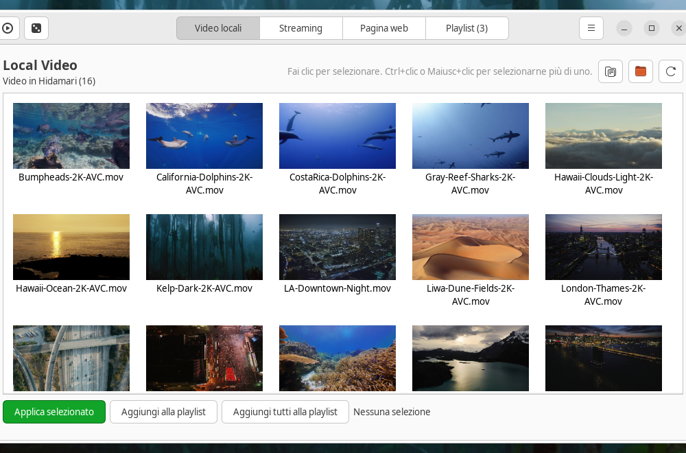
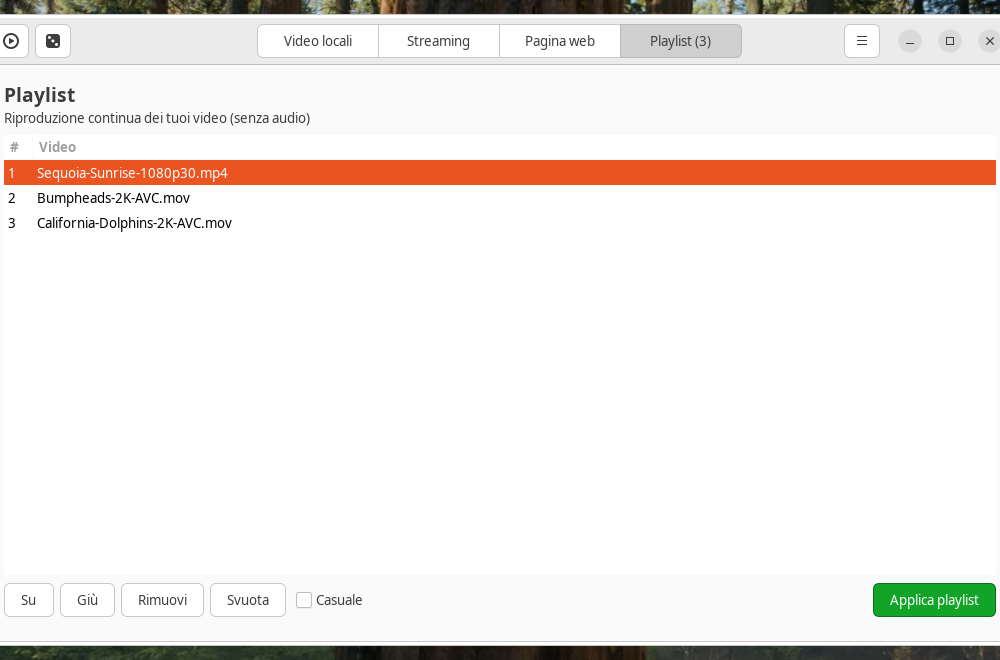

<p align="center"></p>

<p align="center">Live wallpaper for Linux. Written in Python.</p>
<p align="center">Apricus (lat.) — sunny, exposed to the sun.</p>

<p align="center">
<a href="https://github.com/fabx-dev/apricus/actions/workflows/ci.yml"></a>
</p>

# Apricus

Apricus is a community fork of [Hidamari](https://github.com/jeffshee/hidamari)
by Jeff Shee (GPL-3.0, same license). It picks up where Hidamari left off:
**fast login startup, a robust player, per-monitor correctness, and a cleaner
path to Wayland and multi-desktop support**.

> Status: active development on `master`.

## Features

- Autostart after login (`.desktop` file or user systemd unit)
- Instant wallpaper at login: last frame applied immediately, refreshed in background
- Static wallpaper from the current video frame <sup>1</sup>
- Pause on maximized window / fullscreen <sup>2</sup>
- Volume control, mute/pause in two clicks
- I'm feeling lucky (random video)
- Hardware accelerated decoding via VLC <sup>3</sup>
- Multi-monitor support, per-monitor video <sup>4</sup>
- Video library folder of your choice, shown in the panel <sup>5</sup>
- Streaming URL support via yt-dlp <sup>6</sup>
- Webpage as wallpaper <sup>7</sup>
- Interface in English, Italian, German, French, Spanish and Japanese <sup>8</sup>

<sup>1</sup> Currently GNOME only.
<sup>2</sup> Window-state detection is currently X11 only. On Wayland the video
still plays (rendered via XWayland); auto-pause there needs a Shell extension
companion, which is on the roadmap.
<sup>3</sup> VLC backend; HW acceleration varies by driver (NVIDIA + Wayland is fragile).
<sup>4</sup> Duplicate monitor models get stable `Model#i` config keys, so two
identical screens no longer overwrite each other.
<sup>5</sup> Flat scan: each folder shows its own videos. Defaults to the
Hidamari folder for compatibility.
<sup>6</sup> Tested with YouTube.
<sup>7</sup> Anything from a plain page to WebGL content.
<sup>8</sup> Selected automatically from the system locale.

## What changed vs upstream

**Startup & performance**
- Login-to-first-frame from ~1.7s to ~1.4s (1080p): shared process clock with
  `[Perf]` marks, persistent static-frame cache applied instantly and refreshed
  in background, `ffprobe` sidecar cache, no redundant seeks on the startup path
- `--fast` mode and a user systemd unit (`apricus --systemd-enable`) for
  low-contention login startup

**Player**
- Thumbnail loading marshalled to the GTK main thread (fixes intermittent
  native crashes of the control panel)
- VLC widget cleanup, single-shot monitor sync, logging that works in forked
  children, `ffprobe` timeouts, headless-safe imports

**Correctness**
- Stable per-monitor config keys with legacy migration
- Correct dark-mode wallpaper restore; `feeling_lucky` no longer crashes on an
  empty library (upstream #272)
- Old configs are migrated, never wiped (video folder default, blur key
  removal, Hidamari import on first run)

**Desktop integration**
- Desktop-environment backends in one place (`apricus.backends`): GNOME vs
  generic wallpaper handling, X11 vs Wayland window-state selection
- Full rebrand: `io.github.fabx_dev.Apricus` app ID, D-Bus names, original icon
- Flatpak builds and plays video (`make flatpak`; Flathub publishing planned)

**Removed vs upstream**
- Static-wallpaper blur: it only added startup cost for a wallpaper that sits
  underneath the video — frames are now saved sharp and Pillow is gone

## Installation (from source)

Prerequisites per distro are listed in [docs/dev.md](docs/dev.md) — note that
the native `vlc` and `ffmpeg` packages are required (the Flatpak bundles
them). Then:

```bash
git clone --recurse-submodules https://github.com/fabx-dev/apricus.git
cd apricus
make sync      # dev environment (uses system PyGObject)
make install   # installs into ~/.local (no sudo)
```

Run it (via the dev env, in debug mode):

```bash
make run
```

Pick videos from the GUI. On first run Apricus asks you to choose a video
library folder — nothing is assumed or auto-created. (An existing Hidamari
library is reused automatically for compatibility.)

A Flatpak (`io.github.fabx_dev.Apricus`) builds locally with `make flatpak`;
Flathub publishing is planned.

Optional login autostart via systemd (instead of the `.desktop` file):

```bash
apricus --systemd-enable    # disable with --systemd-disable
```

## Development

```bash
make lint     # ruff check
make format   # ruff format
uv run pytest tests/ -q
```

Translatable strings live in `po/` (`make pot` / `make update-po`;
`po/gen_lang.py` regenerates the catalogs). Issues and pull requests are
welcome.

## Credits

- Upstream project: [jeffshee/hidamari](https://github.com/jeffshee/hidamari)
- App icon: original to Apricus
- License: GPL-3.0-or-later (see `COPYING`)

## Screenshots




Legacy Hidamari screenshots (pre-rebrand UI):


